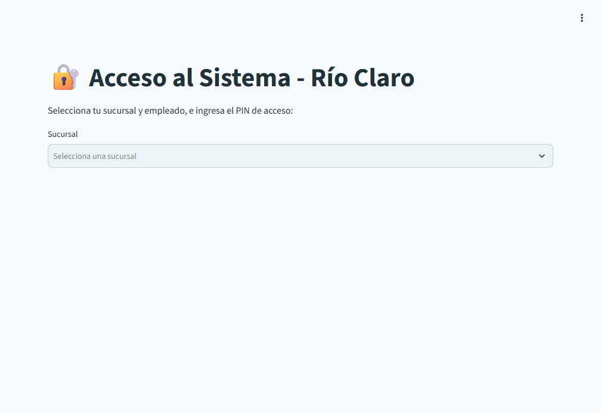

# Río Claro IA — entregable para evaluación AI-901

> Prototipo funcional de demostración. Este documento distingue las funciones implementadas de los resultados que todavía no se han medido. La revisión manual de los perfiles continúa.

## Acceso al prototipo

- **Aplicación:** [Río Claro IA](https://rio-claro-aca-validation.yellowrock-2b43caa9.centralus.azurecontainerapps.io/)
- **Código fuente:** [abeltran0954/rio-claro-ai901-demo](https://github.com/abeltran0954/rio-claro-ai901-demo) — repositorio privado; el propietario debe autorizar el acceso.
- **Instrucciones técnicas:** [README.md](./README.md)

La aplicación se abre como la usaría una persona usuaria normal. Sus perfiles RBAC habilitan funciones según el rol y algunas vistas se limitan a la sucursal del perfil. Solicita un PIN compartido de demostración, que debe obtenerse del propietario por un canal autorizado; no se incluye aquí. El PIN y la selección de empleado no verifican la identidad individual.

## Problema y solución

El caso AI-901 describe una distribuidora con datos dispersos entre sucursales, captura manual de facturas, consultas de clientes sin seguimiento centralizado y reportes inconsistentes. El prototipo reúne en una aplicación web algunos flujos de consulta y registro asistidos por IA:

- consultas de productos y ventas desde el asistente;
- solicitudes de traslado dirigidas a la sucursal proveedora;
- registro de tickets para dar seguimiento a incidencias;
- extracción de campos de facturas y revisión humana antes de autorizar su registro;
- dictado por voz para enviar consultas al asistente.

La solución usa Python y Streamlit, Azure OpenAI, Azure Speech opcional y SQLite. La interfaz se ejecuta en Azure Container Apps. El código utiliza el cliente de Azure OpenAI; no se afirma una integración específica con Microsoft Foundry que no haya sido verificada.

Frente al problema inicial de una carpeta compartida, el prototipo incorpora RBAC para habilitar funciones según el perfil y restringir determinadas vistas por sucursal. La aplicación no implementa un módulo funcional de nómina; esa función solo se menciona como posibilidad futura para RH.

### Adaptación de sucursales

El documento del caso menciona Guadalajara, Zapopan, León, Querétaro y Aguascalientes. Esta instancia adapta el escenario a las sucursales configuradas en la aplicación: Culiacán, Guasave, Los Mochis, Mazatlán y Navolato. Es una adaptación del entorno de demostración; **no** se establece una correspondencia uno a uno entre las sucursales de ambas listas.

## Funciones implementadas

1. **Catálogo y ventas:** el asistente puede consultar productos y datos de ventas disponibles para la demostración.
2. **Traslados entre sucursales:** la sucursal proveedora recibe la solicitud en su bandeja; la solicitud debe indicar producto, cantidad y sucursal proveedora.
3. **Incidencias de clientes:** se pueden registrar tickets asociados con la sucursal responsable.
4. **Captura de facturas:** la IA extrae campos de PDF o imágenes; la persona usuaria revisa y confirma la información antes de autorizar el registro.
5. **Controles de facturación:** se validan campos obligatorios, importes, recepción asociada y duplicados según las reglas implementadas.
6. **Dictado por voz:** Azure Speech transcribe consultas desde el micrófono del navegador cuando está configurado y autorizado.
7. **Control administrativo:** existe un interruptor para deshabilitar la plataforma de IA desde el perfil de Administrador Global.

## Evidencia visual

La siguiente captura corresponde a la pantalla real de acceso de la aplicación. No muestra PIN, información personal ni datos operativos.

Esta versión contiene únicamente esa captura. Para completar la evidencia visual de la evaluación, quedan pendientes capturas sanitizadas de una consulta al catálogo, una operación de traslado y su bandeja receptora, la revisión de una factura de prueba y una consulta por voz. Deben obtenerse después de validar los perfiles y usando datos ficticios o autorizados; no se presentan imágenes simuladas como evidencia.

## Metas de los personajes del caso

| Personaje y meta del caso | Relación con el prototipo | Estado de la meta |
|---|---|---|
| **Don Ernesto, director general:** reportes de ventas consistentes entre cinco sucursales y piloto dentro del presupuesto. | Hay consultas y vistas de ventas; el entorno usa sucursales adaptadas. | No se ha medido que los reportes coincidan entre todas las sucursales ni el costo total del piloto. |
| **Laura, cuentas por pagar:** reducir la captura de unas 12 horas semanales a menos de 2, revisar solo casos dudosos y evitar pagos duplicados. | La IA extrae campos y una persona revisa cada factura antes de aprobarla. Hay validaciones de importes, recepción y folio/proveedor duplicados. | No se ha medido el tiempo ahorrado, la tasa de error ni que se eliminen todos los pagos duplicados. El flujo no demuestra que solo se revisen casos dudosos. |
| **Mariana, gerente de sucursal León:** responder a cualquier cliente en menos de 15 minutos, sin importar de qué sucursal salió el pedido. | Se pueden registrar tickets y mostrarlos en la bandeja de la sucursal responsable. | No se ha medido un tiempo de respuesta menor a 15 minutos ni validado el objetivo para todas las sucursales del caso. |
| **Toño, jefe de bodega:** consultar existencias por voz desde el celular y recibir una respuesta correcta. | El asistente puede consultar el catálogo y el navegador puede dictar consultas mediante Azure Speech. El usuario confirmó en pruebas previas que el dictado y la consulta de productos funcionan. | No se ha medido la precisión de inventario ni completado una prueba sistemática en distintos celulares y navegadores. |
| **Carlos, soporte y sistemas:** accesos por persona, secretos protegidos y capacidad de apagar el sistema ante una falla. | El prototipo aplica RBAC para separar funciones; los secretos se configuran mediante variables de entorno y existe un interruptor administrativo para deshabilitar la IA. | El PIN es compartido y no verifica identidad individual. No se ha configurado Entra ID ni Key Vault. El interruptor no equivale por sí solo a un procedimiento de respuesta a incidentes probado. |

## IA responsable: evidencia y brechas

| Principio | Evidencia en el prototipo | Brecha o límite conocido |
|---|---|---|
| **Equidad** | Las sucursales se normalizan y el asistente recibe el contexto de la sucursal seleccionada. | No hay una evaluación comparativa de calidad o resultados entre sucursales. La lista de esta demo es una adaptación y no replica los datos del caso base. |
| **Confiabilidad y seguridad** | La extracción de facturas requiere revisión humana. Se validan importes, campos, recepción y folio/proveedor duplicado antes de registrar el pago. | No se ha probado sistemáticamente qué ocurre con documentos borrosos o incompletos; la IA puede extraer datos incorrectos. No se garantiza precisión automática. |
| **Privacidad y seguridad** | RBAC habilita módulos por perfil y limita algunas vistas por sucursal. Las consultas SQL de “Consultas Mostrador” se restringen en el servidor al catálogo de productos. Las claves de servicios se leen del entorno y no se incluyen en este documento. | El PIN compartido no verifica identidad individual; Entra ID y Key Vault no están configurados. El contenido de una factura puede enviarse a Azure OpenAI para su análisis; no se afirma que exista una reducción adicional de datos sensibles antes del envío. |
| **Inclusión** | La interfaz permite escribir o dictar una consulta mediante Azure Speech. | No se ha completado una prueba de accesibilidad ni una validación sistemática desde celulares usados por personal de bodega. |
| **Transparencia** | La interfaz identifica que se interactúa con un asistente de IA y muestra el perfil de sesión seleccionado. | Las respuestas no incluyen una cita verificable a cada registro o documento fuente. La selección de empleado no verifica la identidad individual. |
| **Rendición de cuentas** | Una persona revisa y confirma los datos extraídos antes de registrar una factura; el perfil administrador puede deshabilitar la IA. | No se ha demostrado una bitácora completa de aprobación atribuible a una identidad individual ni probado un procedimiento de apagado de extremo a extremo. |

## Arquitectura y limitaciones

| Componente | Implementación |
|---|---|
| Aplicación | Python 3.12+ y Streamlit; la lógica principal está en [`app.py`](./app.py). |
| IA generativa | Azure OpenAI. |
| Voz | Azure Speech opcional, con permiso de micrófono del navegador. |
| Datos | SQLite con datos de demostración. No hay volumen persistente configurado en Azure; los cambios pueden perderse al sustituir la réplica o desplegar otra revisión. |
| Publicación | GitHub Actions construye imágenes y las publica en GitHub Container Registry; Azure Container Apps ejecuta la aplicación. |

- El prototipo aplica RBAC en módulos y en determinadas consultas/vistas por sucursal. El PIN compartido es de demostración y no sustituye la autenticación individual requerida para un despliegue de producción.
- Los modelos pueden equivocarse al transcribir, extraer o interpretar información. Revisa las respuestas y usa solo datos ficticios o autorizados.
- No se afirma que todos los perfiles hayan superado pruebas de aceptación. El usuario continúa revisándolos manualmente.
- El proyecto no tiene una suite automatizada de pruebas configurada.

## Ruta de demostración

1. Solicita al propietario acceso al repositorio privado y el PIN de demostración por separado.
2. Entra por la aplicación web y selecciona una sucursal y un perfil habilitado.
3. Consulta un producto ficticio o autorizado y verifica el resultado contra el catálogo.
4. Si se prueba un traslado, indica producto, cantidad y sucursal proveedora; confirma que aparezca en la bandeja de esa sucursal.
5. Para facturas, utiliza únicamente un documento de prueba autorizado y revisa todos los campos antes de aprobar.
6. Para voz, dicta una consulta completa con pausas naturales y comprueba la transcripción antes de enviarla.
7. Al capturar evidencia, oculta nombres, PIN, datos de clientes, documentos y cualquier otra información sensible.
