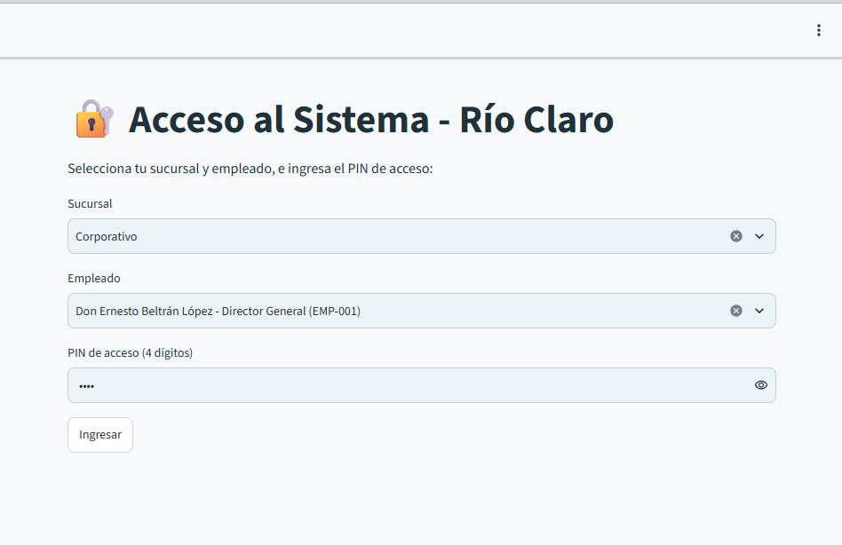
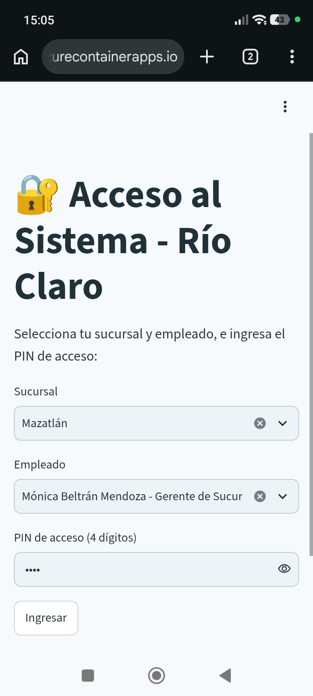
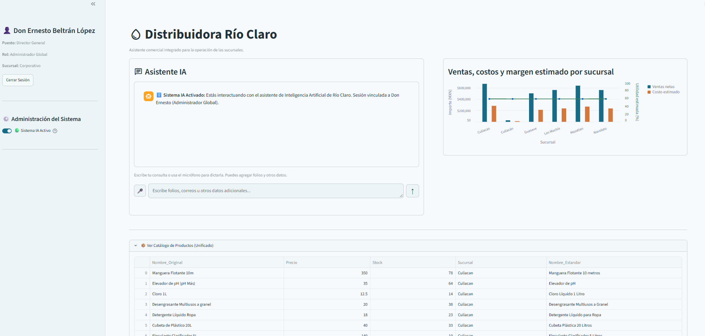
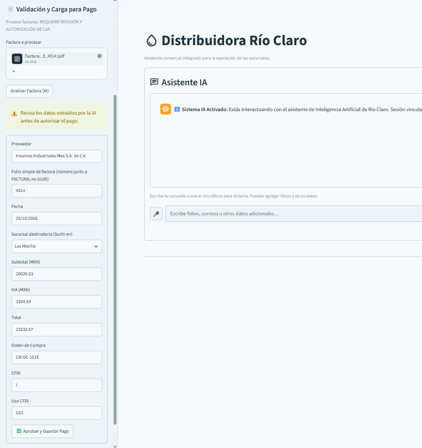

# Asistente Río Claro IA — entregable para evaluación

> Prototipo funcional de demostración del uso de una asistente de IA en la empresa Distribuidora Río Claro desarrollado conforme al escenario planteado en la descripción del proyecto abordando y solventando las dificultades y errores en la operación que hoy presenta el cliente, no sólo resolviendo sino optimizando todos los flujos de trabajo y comunicación dentro de la organización. Solución de asistente que puede evolucionar prácticamente en un ERP según la medida de adaptación y disponibilidad del cliente.&nbsp;

## Acceso al prototipo

- **Aplicación:** [Río Claro IA](https://rio-claro-aca-validation.yellowrock-2b43caa9.centralus.azurecontainerapps.io/)  
- **Código fuente:** [abeltran0954/rio-claro-ai901-demo](https://github.com/abeltran0954/rio-claro-ai901-demo) — repositorio público con datos sintéticos para la demostración.  
- **Información del sistema y guía:** [README.md](./README.md)

## Ruta de demostración

1. Ingrese al Link de la aplicación; utilice el **PIN DE DEMOSTRACIÓN: 1234** para ingresar a cualquier perfil.&nbsp;  
2. Entra por la aplicación web y selecciona una sucursal y un perfil habilitado.  
3. Consulta un producto puedes preguntar naturalmente  y verifica el resultado contra el catálogo.  
4. Si se prueba un traslado, indica producto, cantidad y sucursal proveedora; confirma que aparezca en la bandeja de esa sucursal. Estas solicitudes y mensajes llegan a  los perfiles de Gerencia y Supervisor de Logística de cada sucursal.&nbsp;  
5. Para registro de ventas **(Mazatlán/Gerente)** En el panel lateral esta el boton para cargar la factura, usar el PDF adjunto en la publicación de teams: **VentasMazatlan.pdf,** confirma los datos y aprueba el registro.&nbsp;  
6. Para el alta de inventario **(Los Mochis/Gerente)**  y que dicha factura se habilite para su registro en CxP use el PDF adjunto en el canal de teams: **FacturaComprasMochis.pdf**&nbsp;  
7. Para registro de facturas en cuentas por pagar **(Corporativo/Laura)**, utiliza únicamente un documento de prueba autorizado adjunto en la publicación de Teams: **FacturaComprasMochis.pdf** qué es el mismo que usó en el paso anterior en perfil de gerencia  y revisa todos los campos antes de aprobar.&nbsp;  
8. Para voz, dicta una consulta completa, puedes guiarte de ejemplos de productos desplegando la tabla de productos unificados.&nbsp;  
9. En conversación con el asistente de IA  en cualquier momento puedes crear un reporte o queja de cliente y puedes escribir al mismo tiempo datos como folios, facturas teléfono etc en la caja de texto y el agente unifica ambas entradas y genera el ticket enviándolo a la sucursal correspondiente. Ejemplo: **“Se comunicó el Sr. Pedro Vargas de la ciudad de Navolato para indicar que su pedido que realizó el sábado no ha sido sido surtido aun y le urge que se lo entreguen. Los puede recibir mañana de 9 a 1 pm”**&nbsp;  
10. Valida la llegada del ticket ingresando a el buzón **(Navolato/Gerente)** y verás el ticket.  
11. Puede proceder libremente a explorar las demás funciones y pruebas que desee realizar.

&nbsp;

La aplicación se abre directo en la interfaz de acceso para el personal de la distribuidora. Sus perfiles RBAC habilitan funciones según el rol y algunas vistas se limitan a la sucursal del perfil. Solicita un PIN compartido de demostración, que se encuentra en la Publicación del proyecto; no se incluye aquí.

## Problema y solución

El caso propuesto de Río Claro describe una distribuidora con datos dispersos entre sucursales, captura manual de facturas, consultas de clientes sin seguimiento centralizado y reportes inconsistentes. El prototipo reúne en una aplicación web flujos de consulta y registro asistidos por IA:

- Comprensión del lenguaje natural a través de consultas de productos y ventas desde el asistente;  
- Establecimiento de flujos y órdenes de trabajo  con la voz como las solicitudes de traslado de mercancía dirigidas entre sucursales;  
- registro de tickets para dar seguimiento a incidencias; Siendo cualquier persona la que puede tomar la llamada, correo, mensaje de Whatsapp y convertirlo en un ticket directo de asignación a la sucursal y gerencia correspondiente con solo dictarlo al asistente.&nbsp;  
- Automatización de procesos de captura en documentos comerciales con las medidas de seguridad y confiabilidad de de los datos obtenidos, pues se observan lineamientos como evitar duplicidades, validación de sucursales destino, validación de la información contenida en los documentos para revisión por encargados previo a su procesamiento asegurando la veracidad e integridad de las información. extracción de campos de facturas y revisión humana antes de autorizar su registro;  
- Reconocimiento del lenguaje natural en el dictado por voz para enviar solicitudes de asistencia en procesos o consultas al asistente.

La solución usa Python y Streamlit, Azure OpenAI, Azure Speech opcional y SQLite. La interfaz se ejecuta en Azure Container Apps. El código utiliza el cliente de Azure OpenAI; Uso de agente GPT 4.1mini en Microsoft Foundry.&nbsp;

Frente al problema inicial de una carpeta compartida, el prototipo incorpora RBAC para habilitar funciones según el perfil y restringir determinadas vistas por sucursal. La aplicación no implementa un módulo funcional de nómina; esa función solo se menciona como posibilidad futura para RH.

### Adaptación de sucursales a Sinaloa&nbsp;

El documento del caso menciona Guadalajara, Zapopan, León, Querétaro y Aguascalientes. Esta instancia adapta el escenario a las sucursales configuradas en la aplicación: **Culiacán, Guasave, Los Mochis, Mazatlán y Navolato.** Es una adaptación del entorno de demostración; 

## Funciones implementadas

1. **Catálogo unificado de productos:** el asistente puede consultar productos y datos entre sucursales disponibles para la demostración.  
2. **Traslados entre sucursales:** la sucursal proveedora recibe la solicitud en su bandeja; la solicitud debe indicar producto, cantidad y sucursal proveedora.  
3. **Incidencias de clientes:** se pueden registrar tickets asociados con la sucursal responsable.  
4. **Captura de facturas:** la IA extrae campos de PDF o imágenes; la persona usuaria revisa y confirma la información antes de autorizar el registro.  
5. **Controles de facturación:** se validan campos obligatorios, importes, recepción asociada y duplicados según las reglas implementadas.  
6. **Dictado por voz:** Azure Speech transcribe consultas desde el micrófono del navegador cuando está configurado y autorizado.  
7. **Control administrativo:** existe un interruptor para deshabilitar la plataforma de IA desde el perfil de Administrador Global.

## Evidencia visual

La siguiente captura corresponde a la pantalla real de acceso de la aplicación. No muestra PIN, información personal ni datos operativos.

&nbsp;

&nbsp;

&nbsp;

&nbsp;

&nbsp;

&nbsp;

&nbsp;

## Metas de los personajes del caso

| Personaje y meta del caso | Relación con el prototipo | Estado de la meta |
| :---- | :---- | :---- |
| **Don Ernesto, director general:** reportes de ventas consistentes entre cinco sucursales y piloto dentro del presupuesto. | Hay consultas y vistas de ventas; el entorno usa sucursales adaptadas. | Cubierta: En la interfaz del usuario tiene acceso al chat bot para realizar todas las consultas detalladas sobre ventas, compras y un dashboard con indicadores de ventas y utilidades por sucursal.&nbsp; |
| **Laura, cuentas por pagar:** reducir la captura de unas 12 horas semanales a menos de 2, revisar solo casos dudosos y evitar pagos duplicados. | La IA extrae campos y una persona revisa cada factura antes de aprobar. Hay validaciones de seguridad e integridad de la información que evitan retrabajo o pérdida de tiempo durante la ejecución.&nbsp; | Cubierta: Al ingresar a su perfil cuenta con una sección donde puede subir la factura en PDF o imagen y la IA realiza la extracción de la información mostrándola en celdas para su revisión o corrección cuando los caracteres sin inconsistentes o la información no es exacta, en segundo plano durante la extracción y el registro la IA realiza validaciones de seguridad sobre los documentos, verificando que no exista registro previo evitando duplicidad y la integra de inmediato a la tabla de Cuentas por pagar que también está visible en la interfaz del usuario.&nbsp; |
| **Mariana, gerente de sucursal León:** responder a cualquier cliente en menos de 15 minutos, sin importar de qué sucursal salió el pedido. | Se pueden registrar tickets y mostrarlos en la bandeja de la sucursal responsable. Y aprovechando el mismo canal de comunicación se implementaron funciones adicionales.&nbsp; | Cubierta: Cualquier rol operativo o de contacto con cliente tiene acceso al asistente de chat escrito o por voz para con un simple dictado generar un ticket para seguimiento de reporte o queja de los clientes, el asistente identifica entidades como nombres de los clientes y acorde a la base de datos determina la sucursal que los atiende y envía el ticket a la gerencia y supervisor logístico para su solución.&nbsp; |
| **Toño, jefe de bodega:** consultar existencias por voz desde el celular y recibir una respuesta correcta. | El asistente puede consultar el catálogo en tabla en su interfaz y puede dictar consultas mediante el asistente quien con la información del catálogo unificado de productos responde la información veraz. | Cubierta: El asistente puede ser consultado por medio de PC o teléfonos móviles escribiendo en el chat o hablando con él. Resolviendo toda consulta con datos reales del catálogo unificado de productos aunque el asistente sabe quien le habla y de qué sucursal para responderle propiamente con su informacion tambien ofrece datos de existencias del mismo producto en otras sucursales habilitando la posibilidad de hacer una solicitud de transferencia de mercancía entre tiendas para satisfacer la demanda de producto de los clientes aun cuando el stock no es suficiente.&nbsp; |
| **Carlos, soporte y sistemas:** accesos por persona, secretos protegidos y capacidad de apagar el sistema ante una falla. | El prototipo aplica RBAC para separar funciones; en las funciones particulares se consideró SoD para separar funciones y ordenarlas como medida de aprovisionamiento en flujos de trabajo. los secretos se configuran mediante variables de entorno a nivel técnico y existe un interruptor administrativo para deshabilitar la IA ante alguna fall.&nbsp; | Cubierta: Se resolvieron adecuadamente los problemas que preocupaban a Carlos estableciendo el RBAC y acceso por medio de pines personales e intransferibles, separación de funciones y protección de secretos con rigor técnico así como el interruptor que le permite deshabilitar el sistema en todos los niveles en caso de que llegase a haber alguna falla.&nbsp; |

IA responsable: evidencia y brechas

| Principio | Evidencia en el prototipo | Brecha o límite conocido |
| :---- | :---- | :---- |
| **Equidad** | Las sucursales se normalizan y el asistente recibe el contexto de la sucursal seleccionada, brinda soluciones a cada persona según sus funciones en la empresa.&nbsp; | No hay una evaluación comparativa de calidad o resultados entre sucursales, pero se plantea como adhesión al convertir esta solución de asistente con IA en un ERP funcional.&nbsp; |
| **Confiabilidad y seguridad** | La extracción de facturas requiere revisión humana. Se validan importes, campos, recepción y folio/proveedor duplicado antes de registrar el pago pero en un tiempo instantáneo. En documentos de baja calidad no originales sino escaneados o de foto del celular borrosa la IA realiza una extracción impecable.&nbsp; | No se ha probado qué ocurre con documentos que puedan traer sellos encima del texto o firmas o rayados con pluma; la IA podría extraer datos incorrectos pero siempre estarán habilitados para corregir&nbsp; |
| **Privacidad y seguridad** | RBAC habilita módulos por perfil y limita algunas vistas por sucursal. Las consultas SQL de “Consultas Mostrador” se restringen en el servidor al catálogo de productos. Las claves de servicios se leen del entorno y no se incluyen en este documento. | El PIN compartido no verifica identidad individual por tratarse de una demo pero en implementación se habilita acceso personal e intransferible; Key Vault están configurados para los servicios de autenticación de los recursos de la IA.&nbsp; |
| **Inclusión** | La interfaz permite escribir o dictar una consulta mediante Azure Speech. Y esta disponible para todo el personal administrativo y operativo que necesite sus funciones acorde a su rol. | Las pruebas de accesibilidad se han realizado en equipos de gama baja y media de teléfonos móviles sin embargo falta el desarrollo de una interfaz de alto contraste para personas con dificultad de la visión.&nbsp; |
| **Transparencia** | La interfaz identifica que se interactúa con un asistente de IA y muestra el perfil de sesión seleccionado e indica los límites establecidos para su uso acorde al perfil siempre que se trata de obtener información clasificada o de otras áreas que no corresponden al usuario en sesión.&nbsp; | Las respuestas no incluyen una cita verificable a cada registro o documento fuente. Sino a la base de conocimiento general alimentada por los mismos usuarios La selección de empleado no verifica la identidad individual biometricamente. |
| **Rendición de cuentas** | Una persona revisa y confirma los datos extraídos antes de registrar una factura; el perfil administrador puede deshabilitar la IA. Cada persona es responsable de la atención de las quejas o solicitudes que recibe en su buzón.&nbsp; | No se ha demostrado una bitácora completa de aprobación atribuible a una identidad individual, en algunos procesos ya que una vez que la IA procesa la información de usuarios en el mismo rango por ejemplo no incluye registro de quien la alimenta.&nbsp; |

**Arquitectura y limitaciones**

| Componente | Implementación |
| :---- | :---- |
| Aplicación | Python 3.12+ y Streamlit; la lógica principal está en [`app.py`](./app.py). |
| IA generativa | Azure OpenAI. Agente GPT4.1mini |
| Voz | Azure Speech opcional, con permiso de micrófono del navegador. |
| Datos | SQLite con datos de demostración que fueron generados artificialmente para dar la demostración de funciones completas.&nbsp; |
| Publicación | GitHub Actions construye imágenes y las publica en GitHub Container Registry; Azure Container Apps ejecuta la aplicación. |

El prototipo aplica RBAC en módulos y en determinadas consultas/vistas por sucursal. El PIN compartido es de demostración y no sustituye la autenticación individual requerida para un despliegue de producción.

- Los modelos pueden equivocarse al transcribir, extraer o interpretar información. Revisa las respuestas y usa solo datos ficticios o autorizados.  
- Se confirma que todos los perfiles superaron pruebas de funcionalidad basados en las requisiciones del proyecto.&nbsp;  
- El proyecto no tiene una suite automatizada de pruebas configurada, ofrece en cambio un uso real para probar bajo la autenticación temporal usando el mismo PIN en todos los perfiles.&nbsp;  
12. &nbsp;
